# {{ $frontmatter.title }}

This guide walks you through every step of training subjects in the ViRMEn/DataJoint environment, along with tips and tricks along the way.


## Excel Subject Registry

+ Before you can use ViRMEn, you need to register the subjects you are going to train.
+ Register them in the <a href="https://iowa-my.sharepoint.com/:x:/r/personal/jmunozdelangel_uiowa_edu/_layouts/15/Doc.aspx?sourcedoc=%7B3C3EFF12-0DD5-4FA0-B2CB-1104808CD318%7D&file=ViRMEn_Infrastructure_Data.xlsm&action=default&mobileredirect=true">Excel Subject Registry</a>.

 <figure>
  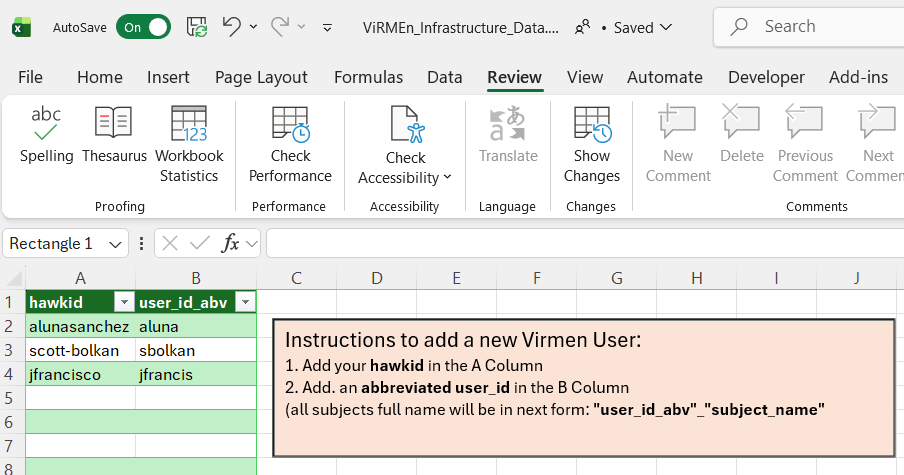
  <center><figcaption>User Registry</figcaption></center>
 </figure>

 <figure>
  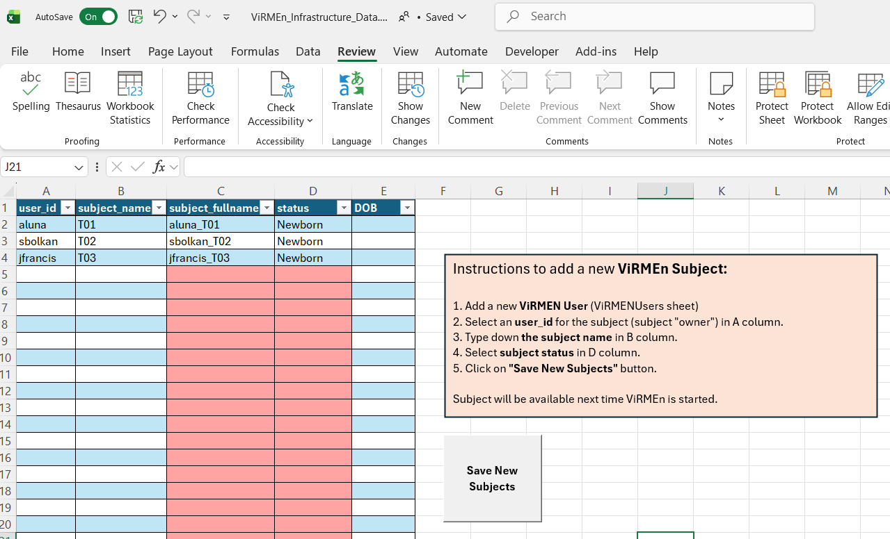
  <center><figcaption>Subject Registry</figcaption></center>
 </figure>

+ **First time only:** go to the **ViRMENUsers** sheet and add your **hawkid** and a **user_id_abv**.
  The **user_id_abv** is used to name all of your subjects, in the format `"user_id_abv"_"subject_name"` (e.g. `aluna_T01`). You can reuse your hawkid as your user_id_abv, but if it is long, a shorter abbreviation is recommended.
+ To add a subject, go to the **VirmenSubjects** sheet and:
  1. Select your **user_id** in column A.
  2. Type the **subject_name** in column B. The **subject_fullname** in column C is filled in automatically.
  3. Select the subject's **status** in column D: `Newborn`, `InExperiments` or `Dead`. (In the future, only `InExperiments` subjects will be shown in the ViRMEn GUI, and `Dead` subjects will be moved automatically to the **PastSubjects** sheet.)
  4. Click the **Save New Subjects** button.
+ The subject will be available to select in the training GUI the next time you start ViRMEn.


## New task creation


### Prerequisites

+ Read the ViRMEn Manual, available in the ViRMEn repository (log in to GitHub first): <a href="https://github.com/Bolkan-Lab/ViRMEn/blob/main/ViRMEn%20manual.pdf">ViRMEn Manual</a>.
+ Each task is made up of six files (two `.mat` files and four `.m` functions) that work together. Each one is described below.

### Experiment code file
+ Located in the **ViRMEn\experiments** directory.
+ Controls stimulus presentation and trial/block progression. This code runs on every frame and is structured as a state machine that follows the trial schema.
+ For a detailed guide on how to modify it, see the ViRMEn Manual.
+ Original file: ```C:\Experiments\ViRMEn\experiments\poisson_blocks.m```
+ Most common use:
 1. Copy the experiment code file from the most similar existing task.
 2. Give the copy a descriptive name (e.g. **"TaskName"_ExperimentCode.m**).
 3. Change the experiment code logic.
 4. See [Tips and Tricks Experiment Code](#tips-and-tricks-experiment-code) below for detailed tips.

 <figure>
  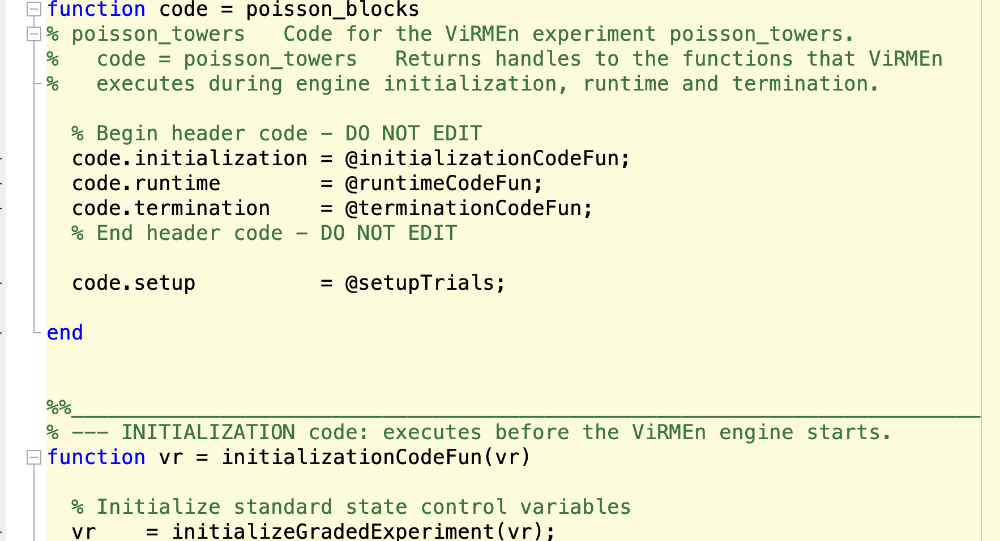
  <center><figcaption>ViRMEn Experiment Code</figcaption></center>
 </figure>

### World file
+ Located in the **ViRMEn\experiments** directory.
+ Defines the structure and settings of the ViRMEn world(s).
+ For a detailed guide on how to modify it, see the ViRMEn Manual.
+ Original file: ```C:\Experiments\ViRMEn\experiments\poisson_blocks.mat```
+ Most common use:
 1. Copy the world file from the most similar existing task.
 2. Give the copy a descriptive name (e.g. **"TaskName"_World.mat**).
 3. Run ```virmen``` in MATLAB and open the world (**Experiment → Open**).
 4. If you don't need to change any objects, just set the **Experiment code** dropdown (bottom-left corner) to your experiment code filename.

 <figure>
  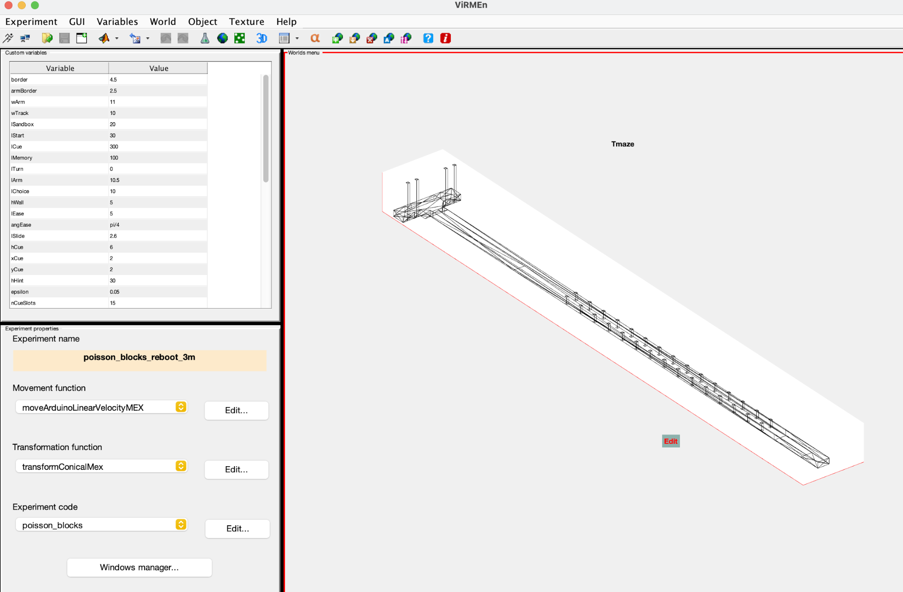
  <center><figcaption>ViRMEn GUI, used to modify world files</figcaption></center>
 </figure>

### Protocol file
+ Located in the **ViRMEn\experiments\protocols** directory.
+ Declares the number of levels, the maze settings, and the criteria that decide when a subject advances to the next level.
+ Original file: ```C:\Experiments\ViRMEn\experiments\protocols\PoissonBlocksCondensed3m.m```

 <figure>
  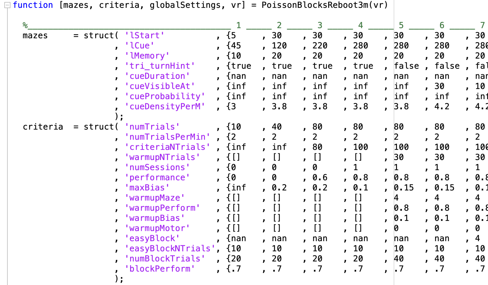
  <center><figcaption>Protocol file code</figcaption></center>
 </figure>

+ The structures and variables in the protocol file are defined below.
 1. Maze structure:

 | Parameter name   | Definition | Values accepted |
 |------------------|------------|-----------------|
 | lStart           | Length of the start region of the track | Real number (>0) |
 | lCue             | Length of the cue region of the track | Real number (>0) |
 | lMemory          | Length of the delay region of the track | Real number (>0) |
 | Tri_turnHint     | Whether turn hints are present at all | Logical |
 | Tri_turnHint_Mem | Whether turn hints are present during the delay period | Logical |
 | cueDuration      | How long towers remain visible after they appear (i.e., whether they disappear after being passed, and if so, after how long) | Real number (>0, in seconds) |
 | cueVisibleAt     | How far from the navigator towers become visible | Real number (>0) |
 | cueProbability   | Probability parameter that sets the ratio of salient to distractor towers | Real number (>0; lower values make the ratio smaller on average) or `inf` (places all towers on the correct side) |
 | cueDensityPerM   | Maximum number of towers per meter in the cue region | Real number |
 | antiFraction     | Proportion of trials in which the correct choice is on the side with fewer towers (i.e., the fraction of trials with inverted reward) | Real number ([0-1]) |
 | world            | Index of the ViRMEn world in `vr.worlds` used by this maze | Index of a ViRMEn world ([1-N], where N is the number of worlds) |

 2. Maze advancement criteria structure:

 | Parameter name   | Definition | Values accepted |
 |------------------|------------|-----------------|
 | numTrials        | Minimum number of trials the subject must spend above the performance criterion | Natural number |
 | numTrialsPerMin  | Number of trials per minute required to count as maintaining "good" performance | Natural number |
 | criteriaNTrials  | Number of trials in the running window used to measure performance when deciding whether to advance to the next maze | Natural number |
 | numSessions      | Minimum number of sessions the subject must spend above criteria before advancing | Natural number |
 | Performance      | Minimum performance required to advance to the next maze | Real number ([0-1]) |
 | maxBias          | Maximum side bias allowed to advance to the next maze | Real number ([0-1]) |
 | warmupMaze       | Index of the ViRMEn world in `vr.worlds` used as the warm-up maze for this main maze, run at the start of each session | Index of a ViRMEn world ([1-N], where N is the number of worlds) |
 | warmupPerform    | Minimum warm-up performance required to advance to the main maze | Real number ([0-1]) |
 | warmupBias       | Maximum side bias allowed during warm-up to advance to the main maze | Real number ([0-1]) |
 | warmupMotor      | Maximum fraction of warm-up trials with "bad" motor quality (too much travel distance inside the maze) | Real number ([0-1]) |
 | easyBlock        | Index of the ViRMEn world in `vr.worlds` used as the easy-block maze for this main maze | Index of a ViRMEn world ([1-N], where N is the number of worlds) |
 | easyBlockNTrials | Number of trials in an easy block | Natural number |
 | numBlockTrials   | Number of trials in the window used to assess performance for demotion to an easy block | Natural number |
 | blockPerform     | If running-window performance (over `numBlockTrials`) drops below this value, the subject switches to an easy block | Real number ([0-1]) |

 3. Protocol extra variables:

 | Parameter name        | Definition | Values accepted |
 |-----------------------|------------|-----------------|
 | globalSettings        | Global settings shared by all mazes | Cell array of name-value pairs (see below) |
 | vr.numMazesInProtocol | Total number of mazes in the protocol | Natural number (usually the length of `mazeIDs`) |
 | vr.stimulusGenerator  | Function that generates the stimuli (i.e., the distribution of towers along the maze) | Function handle (e.g. `@PoissonStimulusTrain`) |
 | vr.stimulusParameters | Stimulus parameters inherited when the experiment runs (parameters that change between mazes but are not defined by the stimuli themselves) | Cell array |
 | vr.inheritedVariables | Maze parameters inherited when the experiment runs (parameters that change between mazes but are not defined by the stimuli themselves) | Cell array |

 4. Global settings variables:

 | Parameter name   | Definition | Values accepted |
 |------------------|------------|-----------------|
 | cueMinSeparation | Minimum distance between two towers on the same side | Real number (>0) |
 | fracDuplicated   | Proportion of trials that are duplicated | Real number ([0-1]) |
 | trialDuplication | Number of times each set of stimulus parameters is duplicated for a given `fracDuplicated` (i.e., the number of exact repeats of each trial type within the duplicated fraction of trials) | Natural number |

### Stimulus bank file

+ Located in the **ViRMEn\experiments\protocols** directory.
+ Contains the stimulus sets drawn from during a session: the tower positions and number of towers for each maze level, generated from the protocol variables.
+ Original file: ```C:\Experiments\ViRMEn\experiments\protocols\stimulus_trains_PoissonBlocksCondensed3m.mat```
+ Most common use:
 1. Create the protocol and world files.
 2. Run the following, replacing **world_file** and **protocol_file** with your file names. Note that the protocol is passed as a function handle (`@`), without quotes or the `.m` extension:
  ```matlab
  generatePoissonStimuli('world_file.mat', @protocol_file)
  ```

### RigParameters file

+ Located in the **ViRMEn\extras** directory.
+ Defines the parameters that control the hardware, display and motion for a task.
+ Only file: ```C:\Experiments\ViRMEn\extras\RigParameters.m```

#### If working on a rig computer:
+ The Lab Manager has most likely already set up this file. Leave it as it is.

#### If working on a personal computer:
+ On a personal computer, this file is mostly used to run ViRMEn simulations without any hardware. To do this, set:
  ```matlab
  simulationMode = true
  hasDAQ         = false
  ```
+ This lets you run simulations on any Windows computer, using the keyboard to simulate the subject's movement.

 <figure>
  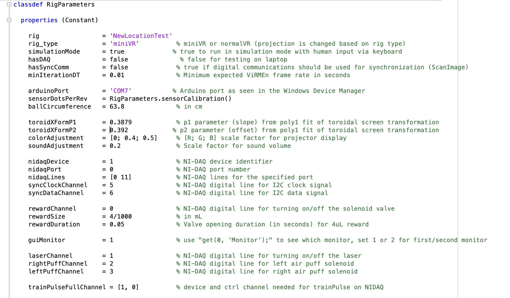
  <center><figcaption>RigParameters file</figcaption></center>
 </figure>


### Program wrapper file

+ Located in the **ViRMEn\experiments\programs** directory.
+ Sets up a cohort of animals in the training GUI.
+ Original file: ```C:\Experiments\ViRMEn\experiments\programs\trainPoissonBlocks_lp_cohort1.m```
+ Most common use:
 1. Copy the program wrapper file from the most similar existing task.
 2. Give the copy a descriptive name (e.g. **train"TaskName"_cohort(n).m**).
 3. In the call to the **runCohortExperiment** function, change the first three parameters:
   + **dataPath:** should be ```C:\Data\(user_id_abv)\(a string that identifies the protocol, task or cohort)```
   + **experName:** should be the experiment code file name (without `.m`).
   + **cohortName:** should be a string that identifies the cohort.
   + **experName** and **cohortName** are appended to the behavior file names.

 <figure>
  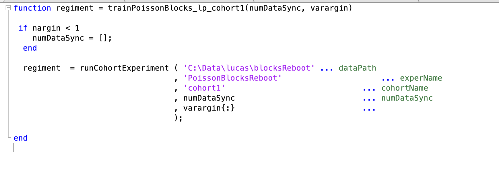
  <center><figcaption>Program wrapper file</figcaption></center>
 </figure>


### Set up training

 1. Make sure you have all the files described in the sections above.
 2. Run your **program wrapper file** (e.g. ```trainPoissonBlocks_lp_cohort1()```).
 3. The training GUI appears:

 <figure>
  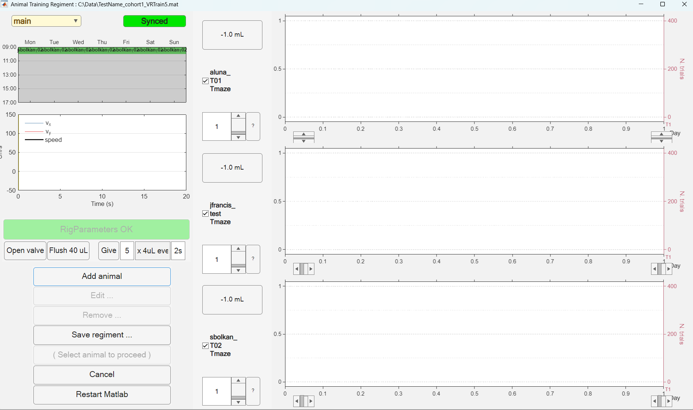
  <center><figcaption>Training GUI main screen</figcaption></center>
 </figure>

 4. Click the **Connect to database** button.
 5. Click the **Add animal** button.

 <figure>
  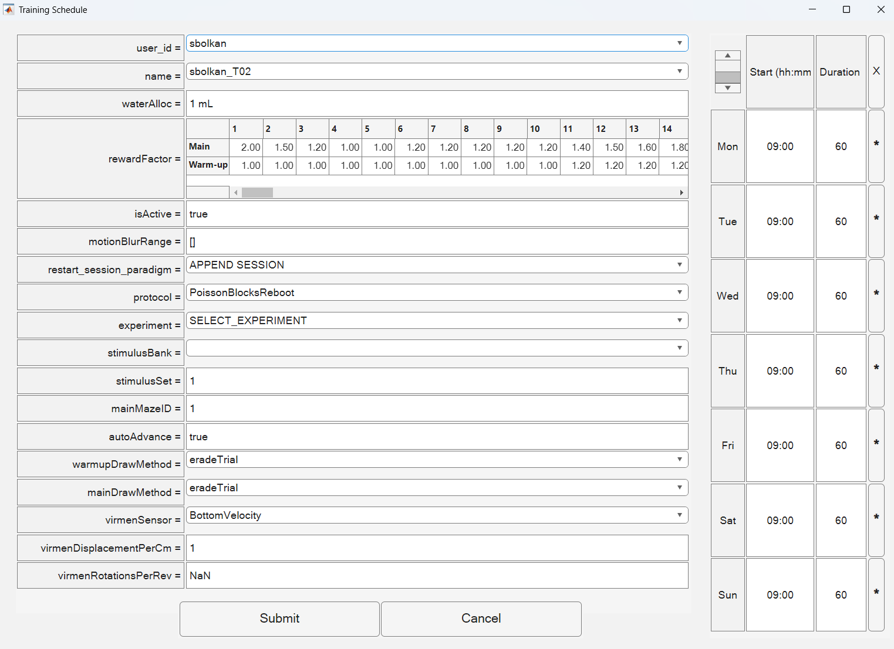
  <center><figcaption>Add animal dialog</figcaption></center>
 </figure>

 6. Fill in the information for the animal you are training (see [Add animal dialog detailed description](#add-animal-dialog-detailed-description)).
 7. Click the **Submit** button.
 8. Repeat steps 5–7 for every animal in the cohort.
 9. Click the **Save regiment** button.
 10. In the subject panel on the right side of the GUI, click the subject you want to train.
 11. Click the **TRAIN "SubjectFullname"** button.

 <figure>
  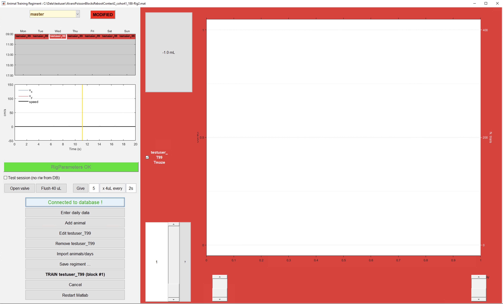
  <center><figcaption>Training GUI main screen with a subject added</figcaption></center>
 </figure>

### Set up motor positioning
+ If the training rig has a motor positioning system (ask the Lab Manager), you need to set the initial coordinates for each subject trained on that rig.

 1. Adjust the subject's position on the rig for the first time using the motor GUI (installed on the rig computer).

 <figure>
  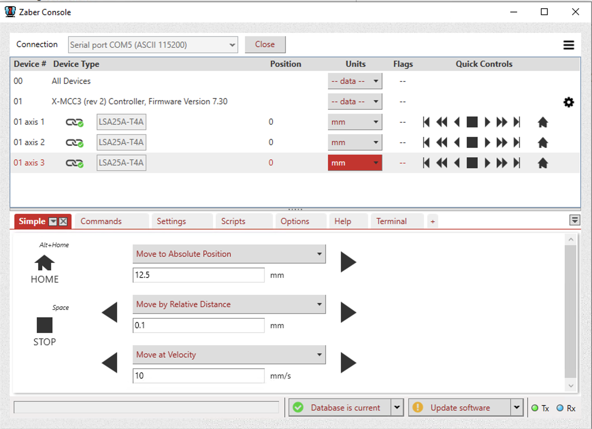
  <center><figcaption>Motor GUI</figcaption></center>
 </figure>

 2. In MATLAB, enter the following, replacing the values with the subject's full name and the positions shown in the motor GUI:
  ```matlab
  new_record = struct;
  new_record.subject_fullname = 'aluna_T01';  % Subject full name
  new_record.ml_position = 17.5;              % ML position in mm (motor axis #1 in the GUI)
  new_record.ap_position = 10;                % AP position in mm (motor axis #2 in the GUI)
  new_record.dv_position = 15.3;              % DV position in mm (motor axis #3 in the GUI)
  insert(subject.LickometerMotorPosition, new_record)
  ```

## Training GUI detailed description

 This section describes every element of the training GUI.

 <figure>
  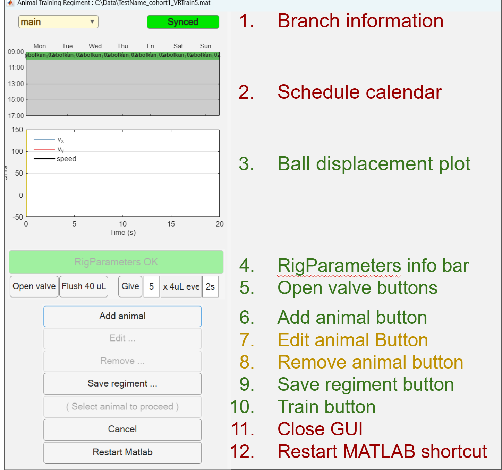
  <center><figcaption>Parts of the training GUI main screen</figcaption></center>
 </figure>

+ On the main screen, elements are color-coded into three categories (<span style="color:red">*red* = rarely or never used; </span><span style="color:rgb(184, 146, 68);">*yellow* = used in specific situations; </span><span style="color:green">*green* = widely used</span>).
 1. **Branch information section:** For git users, shows which branch is checked out and whether the code has uncommitted changes. Most of the time it should read "master" and "synced".
 2. **Schedule calendar:** The days and times when subjects should be trained. This information is not currently needed for training.
 3. **Ball displacement plot:** Shows the subject's real-time X and Y velocity on the rig. Use this plot to detect problems with the ball movement sensor.
 4. **RigParameters info bar:** Turns red whenever simulation mode is on or `hasDAQ` is set to false. Both parameters must be reset before training can start. If you intend to run a simulation, ignore this bar.
 5. **Open valve buttons:** Give the subject on the rig a small reward and/or test that the valve works.
 6. **Add animal button:** Adds a new subject to the cohort. See [Set up training](#set-up-training) and [Add animal dialog detailed description](#add-animal-dialog-detailed-description).
 7. **Edit animal button:** Changes the "Add animal" settings of a subject already in the cohort.
 8. **Remove animal button:** Removes a subject from the cohort (do this when the animal has finished training).
 9. **Save regiment button:** Saves your changes. Click it whenever you add, edit or remove a subject.
 10. **Train button:** Starts training the selected subject.
 11. **Cancel button:** Closes the GUI.
 12. **Restart MATLAB button:** Restarts MATLAB.

### Add animal dialog detailed description

 <figure>
  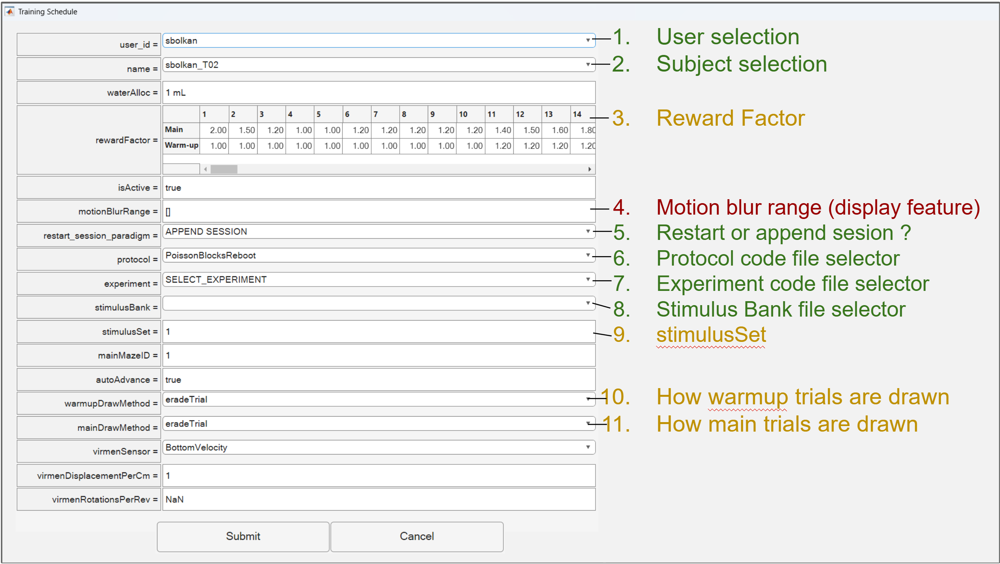
  <center><figcaption>Add animal dialog</figcaption></center>
 </figure>

+ In the Add animal dialog, elements are color-coded into the same three categories (<span style="color:red">*red* = rarely or never used; </span><span style="color:rgb(184, 146, 68);">*yellow* = used in specific situations; </span><span style="color:green">*green* = widely used</span>). Elements not described here are not used.
 1. **User selection:** Dropdown list of all users registered for training.
 2. **Subject selection:** Dropdown list of all Bolkan Lab subjects registered for training. See the [Excel Subject Registry](#excel-subject-registry) for more information.
 3. **Reward factor:** Multiplier applied to the reward in the warm-up and main mazes. The standard reward on the Towers Task is 4 µL per correct trial (e.g. ```RewardFactor = 1.25 -> Reward = 4 * 1.25 = 5 µL```).
 4. **Motion blur range:** Sets up the cue elongation effect, which stretches cues opposite to the subject's direction of motion in virtual reality. It is a 2×1 vector: the first element is the distance (in cm) from the subject to the tower at which elongation starts, and the second is the distance (in cm) at which it stops. Leave it empty for no motion blur. Common values: ```[28 5]```, ```[]```.
 5. **Restart or append session:** What happens when a session is restarted.
   + **APPEND SESSION:** each restart is recorded as new blocks of the same session.
   + **START NEW SESSION:** each restart creates a new session (recommended during physiology recordings, as it makes syncing easier).
 6. **Protocol code file selector:** Dropdown to select the protocol code file. See [New task creation](#new-task-creation) for details.
 7. **Experiment code file selector:** Dropdown to select the experiment code file. See [New task creation](#new-task-creation) for details.
 8. **Stimulus bank file selector:** Dropdown to select the stimulus bank file. See [New task creation](#new-task-creation) for details.
 9. **Stimulus set edit:** If the stimulus bank contains more than one set, choose it here. Only change this if you understand the stimulus bank file in depth.
 10. **How warm-up trials are drawn:** Strategy for choosing left or right trials based on the subject's recent bias and performance. The default is `eradeTrial`, described <a href="https://pubmed.ncbi.nlm.nih.gov/11550944/">here</a>.
 11. **How main trials are drawn:** Strategy for choosing left or right trials based on the subject's recent bias and performance. The default is `eradeTrial`, described <a href="https://pubmed.ncbi.nlm.nih.gov/11550944/">here</a>.

### ViRMEn Experiment Stats GUI & maze projection

- When you click the **TRAIN** button, the ViRMEn experiment starts and the ViRMEn Experiment Stats GUI appears. This GUI monitors the subject's performance throughout the session.


 <figure>
  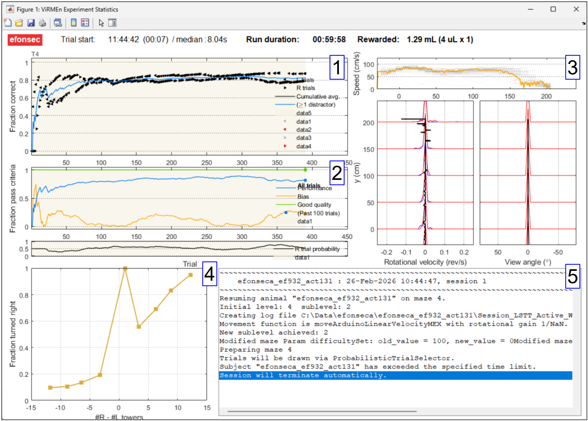
  <center><figcaption>ViRMEn Experiment Stats GUI</figcaption></center>
 </figure>


+ Each part of the ViRMEn Experiment Stats GUI is described below.
 1. **Fraction correct plot:** Overall, left and right performance across all blocks of the session.
 2. **Pass criteria plot:** Performance and bias over the last 40 trials. These values determine whether the subject is promoted to the next level.
 3. **Speed, rotation & angle plots:** Movement variables from the last trial, used to check that the movement sensor works and to monitor the subject's side bias.
 4. **Psychometric plot:** Percentage of right choices as a function of the difference between right and left towers. For a well-trained subject, this curve should look roughly sigmoidal.
 5. **Message text area:** Logs session milestones, such as a new level reached, a forced reward delivery or a level demotion.

- Alongside the Experiment Stats GUI, the virtual world is shown on the rig projector. It looks something like this:

 <figure>
  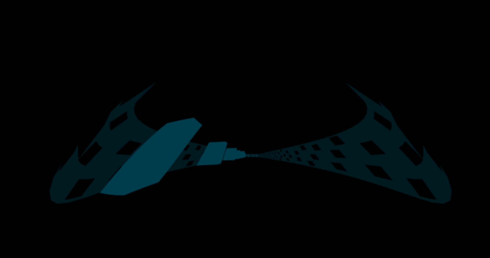
  <center><figcaption>ViRMEn maze projection</figcaption></center>
 </figure>

## Tips and Tricks Experiment Code

### Add variables to the behavior file

+ You will often need to store extra variables in the behavior file for later analysis.

#### Add trial-level variables
 1. Go to the ```setupTrials``` function in the experiment code.
 2. Find a line like this one: ```cfg.trialData         = { 'trialProb', 'trialType', 'choice', 'trialID' ... ```
 3. Add your variable name at the end of the **cfg.trialData** cell array.
+ Make sure the variable is defined as `vr.(variableName)` in ```initializationCodeFun()``` or ```runtimeCodeFun()``` before the first trial ends.

#### Add block-level variables
 1. Go to the ```setupTrials``` function in the experiment code.
 2. Find a line like this one: ```cfg.blockData         = { 'mazeID', 'mainMazeID', 'motionBlurRange', 'iterStr', 'shapingProtocol' ... ```
 3. Add your variable name at the end of the **cfg.blockData** cell array.
+ Make sure the variable is defined as `vr.(variableName)` in ```initializationCodeFun()``` or ```runtimeCodeFun()``` before the first trial ends.

### Make the code simulation-ready

+ It is useful to make the experiment code simulation-ready, so you can test every change without touching the rig hardware.
+ Simulation-ready code can also be used to make trial-by-trial videos with the <a href="https://github.com/BrainCOGS/ReproduceTrialTowers">ReproduceTrialTowers repository</a>.
 1. Find every line in the experiment code that talks to the hardware: all lines starting with **nidaq** and the **updateDAQSyncSignals** function.
 2. Wrap those lines in an ```if RigParameters.hasDAQ ... end``` block.

## Solving common errors during training

### Arduino serial communication error

+ Errors like these:
 ```matlab
 Open failed: Port: COM7 is not available. Available ports: COM1.
 Use INSTRFIND to determine if other instrument objects are connected to the requested device.
 ```
 ```matlab
 Serial communications have not been properly initiated.
 ```
 ```matlab
 Device Error: Unanticipated host error
 ```
+ These are the most common errors during training. Check that the Arduino's COM port appears in Device Manager, then restart MATLAB and/or the computer.

### ViRMEn variable not set

 ```matlab
 Reference to non-existent field (variable_name)...
 ```
 ```matlab
 Unrecognized field name (variable_name).
 ```
+ Fix this error by initializing the variable in ```initializationCodeFun()``` (e.g. ```vr.(variable_name) = 0```).

### NI-DAQ channel is busy or not found

```matlab
 [nidaqPulseRightReward:commit]  Requested operation could not be performed, because the specified digital lines are either reserved or the device is not present in NI-DAQmx.
 It is possible that these lines are reserved by another task or the device is being reset. If you are using these lines with another task, wait for the task to complete.  If you want to force the other task to relinquish the device, reset the device. If you are resetting the device, wait for the reset to finish.
 Device:  Dev1

 Task Name: RightReward

 Status Code: -200587
```
+ Check **RigParameters.m** and make sure no two input/output channel variables share a channel (`rewardChannel`, `laserChannel`, `rightPuffChannel`, `leftPuffChannel`, `rightRewardChannel`, `leftRewardChannel`, `newIterationChannel`, `newTrialChannel`, etc.).
